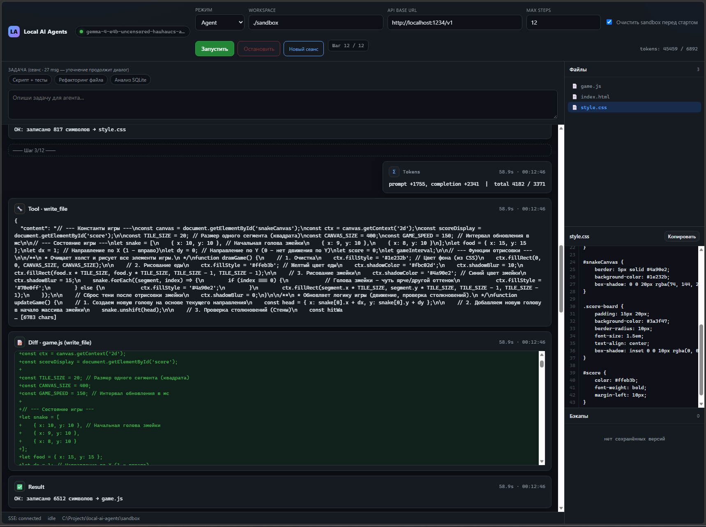

English | [Русский](README_RU.md)

# local-ai-agents



Lean pure-Python lab for **local 4B–12B** models (and any OpenAI-compatible gateway). Token-efficient: only **4 workspace tools**, LM Studio `state: loaded` auto-detection, offline Web UI (no CDN), zero LangChain / CrewAI.

| Mode | File | Pattern |
|------|------|---------|
| Agent | `agent.py` | ReAct + 4 tools |
| Workflow | `workflow.py` | Evaluator-Optimizer |
| Multi-Agent | `multi_agent.py` | Architect → Coder ↔ Reviewer |
| Web-UI | `ui.py` + `static/index.html` | Dark offline UI (SSE) |

## Installation

**Windows (PowerShell):**

```powershell
cd C:\Projects\local-ai-agents
python -m venv .venv
.\.venv\Scripts\Activate.ps1
pip install -r requirements.txt
```

**Linux / macOS:**

```bash
cd /path/to/local-ai-agents
python3 -m venv .venv
source .venv/bin/activate
pip install -r requirements.txt
```

In LM Studio, start the server (port `1234`) and load **one** chat model. Embedding models are ignored; only models with `"state": "loaded"` are preferred.

## Quick start (Web-UI)

```powershell
.\.venv\Scripts\python.exe ui.py
```

```bash
.venv/bin/python ui.py
```

Or double-click `start_ui.bat`. Opens `http://localhost:8080`.

Header: model, mode (`Agent` / `Workflow` / `Multi-Agent`), workspace, optional API Base URL, max steps, sandbox clean, context meter, tok/s, Run / Stop / New session. Multi-Agent exposes optional per-role model fields.

Center feed streams SSE steps (Reasoning / Think, Thought, tool calls, diffs, `run_command` cards). Presets: Script + tests, Refactor, Tests / pytest. Agent mode keeps `messages` between runs (also in `.agent_sessions.db`). Right panel: Sessions, file tree, Backups / Rollback.

## CLI

```powershell
.\.venv\Scripts\python.exe agent.py --task "Write hello.py and pytest it" --workspace ./sandbox
.\.venv\Scripts\python.exe workflow.py --task "Print Fibonacci up to 10"
.\.venv\Scripts\python.exe multi_agent.py --task "CSV stats CLI"
```

Flags: `--model`, `--base-url`, `--api-key`, `--workspace`, `--clean` (default `./sandbox` only), `--max-steps`, `--auto-test` / `--no-auto-test` (agent).

## Gateways / env

| Variable | Default | Purpose |
|----------|---------|---------|
| `LLM_BASE_URL` | `http://localhost:1234/v1` | Gateway URL |
| `LLM_API_KEY` | `lm-studio` | API key |
| `LLM_MODEL` | *(empty)* | Explicit model; else auto |
| `LLM_CONTEXT_LIMIT` | `32768` | UI context meter |

`get_active_model()` (in `llm.py`) lists models once, skips `*embed*`, prefers `"state": "loaded"` (LM Studio). If no `state` field (OpenRouter / plain OpenAI-compatible), falls back to the first chat model.

## Layout

```
local-ai-agents/
├── agent.py            # Workspace + 4 tools + ReAct agent
├── llm.py              # Client, retry, compact, fallback parser, get_active_model
├── multi_agent.py      # Architect → Coder ↔ Reviewer (same 4 tools)
├── workflow.py         # Generator → run → critic (write_file + run_command)
├── ui.py               # ThreadingHTTPServer + SSE
├── sessions.py         # SQLite sessions (.agent_sessions.db)
├── events.py           # Event bus
├── static/index.html   # Offline UI
├── tests/              # pytest
├── Dockerfile / docker-compose.yml
└── start_ui.bat
```

## Four core tools

All paths are resolved under `WORKSPACE_DIR` (default `./sandbox`). `../` and absolute paths are rejected.

| Tool | Role |
|------|------|
| `list_files` | List workspace files (hides `__pycache__` / `.git` / `.venv` / `.agent_backup` / `*.pyc`) |
| `read_file` | Read with line numbers |
| `write_file` | Create/overwrite + `.agent_backup` + `ast.parse` warning for `.py` |
| `run_command` | Allowlisted (`shell=False`): `pytest`, `python -m pytest`, `python script.py`, `unittest`, `ruff`/`flake8`/`mypy`, `git status`/`diff`/`log`; rejects `; && \|\| \| > < \` $()` |

## Workspace & backups

- `--workspace` / `set_workspace()` sets the active root; tools cannot escape it.
- `--clean` only for the default `./sandbox`.
- Overwriting a file copies the previous version to `<workspace>/.agent_backup/`.
- UI: `GET /api/backups`, `POST /api/rollback`; session diff uses the first backup per file.

## Modes (short)

- **Agent** — ReAct with `BASIC_TOOLS_SCHEMA` (4 tools). Compacts old tool outputs, injects working-memory summary, auto-pytest after `.py` edits when tests exist.
- **Workflow** — generator writes `solution.py` → `python solution.py` → critic returns full fixed code via `write_file` (≤3 cycles).
- **Multi-Agent** — Architect writes `plan.md`, Coder implements `solution.py`, Reviewer writes/runs `test_solution.py`; up to 2 bugfix cycles. Same 4 tools for every role.

## Docker

```powershell
docker compose up --build
```

UI at `http://localhost:8080`; `./sandbox` is mounted. Gateway on the host via `host.docker.internal:1234`.

## Tests

```powershell
.\.venv\Scripts\python.exe -m pytest tests -q
```

Covers path traversal, the 4 tools, `run_command` allowlist, `get_active_model` loaded-state filtering, mentions, session store, and fallback tool-call parsing.
