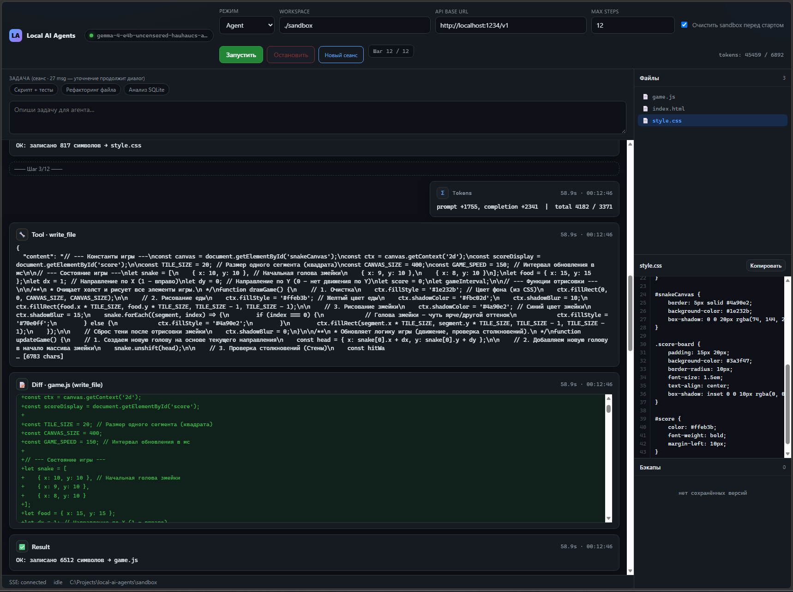

[English](README.md) | Русский

# local-ai-agents



Лёгкий чистый Python-стенд под локальные модели **4B–12B** (и любой OpenAI-совместимый шлюз). Экономия токенов: только **4 workspace-инструмента**, автовыбор LM Studio `"state": "loaded"`, офлайн Web-UI без CDN, без LangChain / CrewAI.

| Режим | Файл | Паттерн |
|-------|------|---------|
| Agent | `agent.py` | ReAct + 4 тула |
| Workflow | `workflow.py` | Evaluator-Optimizer |
| Multi-Agent | `multi_agent.py` | Архитектор → Кодер ↔ Ревьюер |
| Web-UI | `ui.py` + `static/index.html` | Тёмный офлайн UI (SSE) |

## Установка

**Windows (PowerShell):**

```powershell
cd C:\Projects\local-ai-agents
python -m venv .venv
.\.venv\Scripts\Activate.ps1
pip install -r requirements.txt
```

**Linux / macOS:**

```bash
cd /path/to/local-ai-agents
python3 -m venv .venv
source .venv/bin/activate
pip install -r requirements.txt
```

В LM Studio запустите сервер (порт `1234`) и загрузите **одну** чат-модель. Embedding-модели игнорируются; предпочтение — модели с `"state": "loaded"`.

## Быстрый старт (Web-UI)

```powershell
.\.venv\Scripts\python.exe ui.py
```

```bash
.venv/bin/python ui.py
```

Или `start_ui.bat`. Откроется `http://localhost:8080`.

Шапка: модель, режим (`Agent` / `Workflow` / `Multi-Agent`), workspace, опциональный API Base URL, max steps, очистка sandbox, метр контекста, tok/s, Run / Stop / Новый сеанс. В Multi-Agent — поля моделей по ролям.

Центральная лента — SSE (Reasoning / Think, Thought, tool calls, diff, карточки `run_command`). Пресеты: Скрипт + тесты, Рефакторинг, Тесты / pytest. В Agent история `messages` живёт между запусками (и в `.agent_sessions.db`). Справа: Sessions, дерево файлов, Backups / Rollback.

## CLI

```powershell
.\.venv\Scripts\python.exe agent.py --task "Напиши hello.py и прогони pytest" --workspace ./sandbox
.\.venv\Scripts\python.exe workflow.py --task "Печать Фибоначчи до 10"
.\.venv\Scripts\python.exe multi_agent.py --task "CLI статистики CSV"
```

Флаги: `--model`, `--base-url`, `--api-key`, `--workspace`, `--clean` (только дефолтный `./sandbox`), `--max-steps`, `--auto-test` / `--no-auto-test` (agent).

## Шлюзы / env

| Переменная | По умолчанию | Назначение |
|------------|--------------|------------|
| `LLM_BASE_URL` | `http://localhost:1234/v1` | URL шлюза |
| `LLM_API_KEY` | `lm-studio` | API-ключ |
| `LLM_MODEL` | *(пусто)* | Явная модель; иначе авто |
| `LLM_CONTEXT_LIMIT` | `32768` | Метр контекста в UI |

`get_active_model()` в `llm.py` один раз читает `models.list`, отбрасывает `*embed*`, предпочитает `"state": "loaded"` (LM Studio). Если поля `state` нет (OpenRouter / обычный OpenAI-compatible) — берёт первую чат-модель.

## Структура

```
local-ai-agents/
├── agent.py            # Workspace + 4 тула + ReAct-агент
├── llm.py              # Клиент, retry, compact, fallback-парсер, get_active_model
├── multi_agent.py      # Архитектор → Кодер ↔ Ревьюер (те же 4 тула)
├── workflow.py         # Генератор → запуск → критик (write_file + run_command)
├── ui.py               # ThreadingHTTPServer + SSE
├── sessions.py         # SQLite-сессии (.agent_sessions.db)
├── events.py           # Шина событий
├── static/index.html   # Офлайн UI
├── tests/              # pytest
├── Dockerfile / docker-compose.yml
└── start_ui.bat
```

## Четыре инструмента

Все пути резолвятся внутри `WORKSPACE_DIR` (по умолчанию `./sandbox`). `../` и абсолютные пути отклоняются.

| Тул | Назначение |
|-----|------------|
| `list_files` | Список файлов (без `__pycache__` / `.git` / `.venv` / `.agent_backup` / `*.pyc`) |
| `read_file` | Чтение с номерами строк |
| `write_file` | Создание/перезапись + `.agent_backup` + предупреждение `ast.parse` для `.py` |
| `run_command` | Allowlist (`shell=False`): `pytest`, `python -m pytest`, `python script.py`, `unittest`, `ruff`/`flake8`/`mypy`, `git status`/`diff`/`log`; запрещает `; && \|\| \| > < \` $()` |

## Workspace и бэкапы

- `--workspace` / `set_workspace()` задаёт корень; тулы не выходят за него.
- `--clean` только для дефолтного `./sandbox`.
- При перезаписи файла копия уходит в `<workspace>/.agent_backup/`.
- UI: `GET /api/backups`, `POST /api/rollback`; diff сессии — первый бэкап файла.

## Режимы (кратко)

- **Agent** — ReAct с `BASIC_TOOLS_SCHEMA` (4 тула). Сжимает старые tool-выводы, вставляет working-memory, авто-pytest после правок `.py` при наличии тестов.
- **Workflow** — генератор пишет `solution.py` → `python solution.py` → критик отдаёт полный исправленный код через `write_file` (≤3 цикла).
- **Multi-Agent** — Архитектор пишет `plan.md`, Кодер — `solution.py`, Ревьюер — `test_solution.py`; до 2 циклов багфиксов. У всех ролей одни и те же 4 тула.

## Docker

```powershell
docker compose up --build
```

UI: `http://localhost:8080`; `./sandbox` смонтирован. Шлюз на хосте: `host.docker.internal:1234`.

## Тесты

```powershell
.\.venv\Scripts\python.exe -m pytest tests -q
```

Покрывают path traversal, 4 тула, allowlist `run_command`, фильтр `get_active_model` по `loaded`, mentions, session store и fallback tool-call parser.
